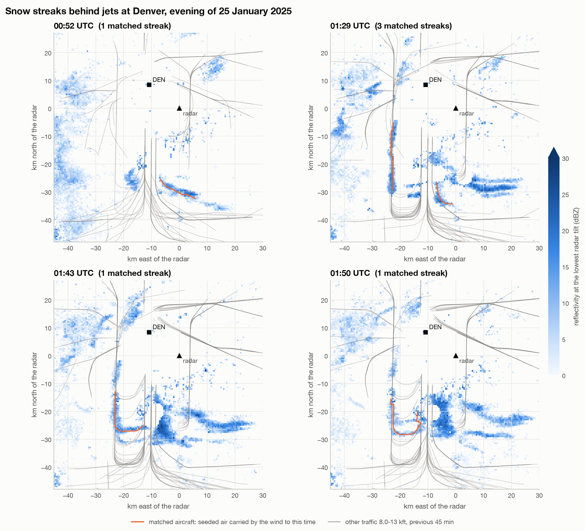
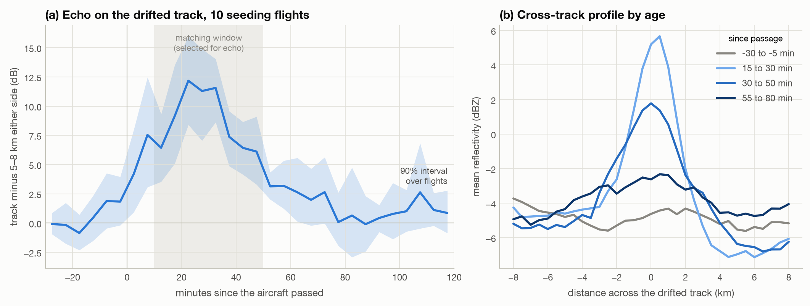
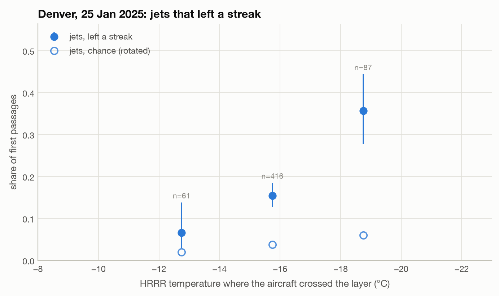

# Aircraft-made snow: an automated census from open radar and flight data

*Draft. The Denver case study and the method are complete; the multi-airport census and its
calibration are running, and their sections will be filled in from the results.*

## Summary

Aircraft climbing or descending through clouds of supercooled droplets can freeze some of
them; the ice grows, falls and drifts with the wind, and weather radar sees a narrow band
of snow that traces the flight path, displaced downwind. This had been shown in individual
cases. This project builds an automated detector for these streaks in NEXRAD radar data,
matches each streak to the single aircraft that made it using open ADS-B tracks, and
measures how often chance alone would produce such a match.

On 25 January 2025 at Denver International Airport, the detector finds streaks from 10
identified jets at a false discovery rate of about 6% (0.6 false matches expected), the
day's combined evidence exceeding all 200 rotated flight sets (gamma-tail p = 5e-5). The
matched seeding points imply fall speeds of 0.4-1.7 m/s, as for snow. Of the jets whose
first passage through the cloud layer could be followed, 36% of those at -17 to -20 C left
a streak, falling to 15% at -14 to -17 C and 7% at -11 to -14 C (chance: 2-6%).

## 1. Background

See `docs/background.md`. In short: aircraft-produced ice particles (APIPs) were shown in
field tests in the 1980s-2000s; Heymsfield et al. (2010, 2011) documented hole-punch and
canal clouds from commercial aircraft and estimated that conditions allowing it occur up
to ~6% of the time at major airports; Moisseev et al. (2019) found aircraft-intensified snow
by inspecting 11 years of Helsinki radar; Iwasaki & Fujii (2025) matched 59 hole-punch clouds
in satellite imagery to Flightradar24 tracks. No study has counted radar-visible
aircraft-made snow across airports and winters, or measured which aircraft make it and at
what temperatures.

## 2. Data

| Source | Use |
|---|---|
| adsb.lol open ADS-B history (ODbL), March 2023 onward | aircraft positions every 10-20 s, pressure altitude |
| NEXRAD Level III N0B (AWS) | lowest-tilt reflectivity, 0.5 deg x 250 m |
| NEXRAD Level II (AWS) | dual-polarisation moments for the case study |
| HRRR analyses (Utah Zarr archive) | hourly temperature, humidity, wind profiles |
| tar1090-db | aircraft type and engine class |
| Iowa Environmental Mesonet | METARs |

## 3. Method

See `docs/methods.md` for the full description and the lessons from building it. In brief:

1. Streak-shaped echo objects (long, thin, at most 35 dBZ) are found in each radar scan by
   morphology alone.
2. Each is compared with every flight that passed 10-50 minutes earlier, its track carried
   by the HRRR wind between the radar beam and the flight's level (with up to 1 m/s of
   allowed wind error). The match must cover the streak and lie along it, and the air must
   have been echo-free before the aircraft arrived.
3. Only physically possible seeding counts: the aircraft must have been in air at or below
   -4 C, and high enough above the radar beam that ice falling at 0.2-2 m/s (the range for
   snow) would reach the beam at the observed age.
4. Chance is measured by repeating everything with all flights rotated about the radar,
   and checked with flights translated instead (which keeps their orientation to the wind).
5. A radar-day is scored by the combined evidence of its matched flights, against the same
   score for each rotated flight set; across the census, days are selected at a 5% false
   discovery rate after calibrating the score's tail on the rotations themselves.

Aircraft echoes are removed from the radar where the beam saw each aircraft, helicopters and
slow aircraft are excluded from matching, and fixed clutter is removed by persistence.

## 4. The Denver case, 25 January 2025

*Lowest-tilt reflectivity of the Denver radar (KFTG) at six times, with the traffic of the
previous 45 minutes (grey) and, in orange, the air each matched aircraft flew through,
carried by the wind to the scan time.*

- **Conditions.** An easterly upslope flow (6-11 kt at the airport, -8 C at the surface)
  under broken to overcast cloud at 3 500-5 000 ft above the airport (mostly 4 600-4 800 ft,
  about 3.1 km above sea level), light snow on and off. HRRR has a moist layer (83-88% relative humidity) up to about 3.3 km at
  -18 to -19 C, capped by an inversion that warms to -12 C near 3.9 km; it has no cloud
  water in it, a known weakness for thin supercooled stratus.
- **Streaks.** Matched streaks appear from 19:55 to 03:51 UTC (12:55-20:51 local time),
  11-31 km long and 1.8-3.1 km wide, with peak reflectivity 13.5-25 dBZ, mostly along the
  downwind, base and final legs of the arrival pattern south-west of the airport.
- **Aircraft.** 10 flights at p <= 0.005 against 200 rotated flight sets (0.6 false
  matches expected): CRJ-200 (3), E175, A320, 737-800, 737 MAX 8, 737-900, 787-9 and a
  Citation Latitude business jet; 9 arrivals and 1 departure. Their seeding points lie at
  9 100-12 900 ft pressure altitude (2.8-3.9 km), mostly about 3.0 km, near the reported
  cloud base, at HRRR temperatures of -14.5 to -18 C. The streaks were seen 15-46 minutes
  after the aircraft passed.
- **Physical consistency.** The seeding points were 0.7-2.0 km above the radar beam, which
  over the observed delays implies fall speeds of 0.4-1.7 m/s (median 0.64 m/s): the speeds
  of snow crystals and aggregates. The drift that best fits each streak is within 1 m/s of
  the HRRR wind for 9 of 12 streaks; allowing up to 3 m/s improves the fit by a median of
  only 0.01 in F1.
- **Life cycle.** Following the matched flights' air through every scan, echo on the
  drifted track rises to about 12 dB above lines 5-8 km either side at 20-35 minutes, with
  a width of about 3 km, then weakens and spreads, and is close to background after about
  an hour. (Between 10 and 50 minutes the composite is shaped by how flights were selected;
  its width and decay are not.)

  

- **Particles.** Compared scan by scan with other echo of the same strength, streak echo
  has a higher correlation coefficient in every scan (11 of 11 at 0-10 and at 10-20 dBZ;
  medians 0.992 vs 0.982 and 0.993 vs 0.985), i.e. more uniform particles. Its
  differential reflectivity is lower for weak echo (0-10 dBZ, 11 of 11 scans) but not at
  10-20 dBZ (higher in 7 of 11). The weak-echo difference may say as much about the noisier
  background echo as about the streak particles.
- **How many jets did it.** Of the jets that crossed the seeding layer into echo-free air
  (first passages), the share whose drifted track carried a streak rose with cold: 36% at
  -17 to -20 C (31 of 87), 15% at -14 to -17 C (64 of 416) and 7% at -11 to -14 C (4 of
  61), against 6%, 4% and 2% for the same flights rotated about the radar. The 14
  turboprops that crossed left none. The warmer bins include flights below the cloud base,
  so this is an upper bound on how fast efficiency falls with temperature, not a measured
  threshold.

  

- **How much snow.** With Ze = 110 S^2 (Wolfe & Snider 2012), the streaks averaged 0.2-0.4
  mm/h of snow (water equivalent), up to 1.7 mm/h in their cores, and each was depositing
  roughly 5 000-23 000 tonnes of water per hour at its matched scan. That is comparable,
  over half an hour, to all the liquid water a cloud this thin holds, so either the ice
  also grew from vapour or the relation overstates snowfall for young, small crystals; the
  amounts are uncertain by a factor of several.
- **Ground.** Stations at Denver International, Buckley SFB and Centennial reported light
  snow on and off through the afternoon and evening, so hourly reports cannot separate the
  aircraft's contribution at the surface.

## 5. Calibration

*To be completed from the July null runs, the January runs, the time-reversed diagnostic
and the injection-recovery tests.*

## 6. Census

*To be completed.*

## 7. Limitations

- Detection is limited to seeding within roughly 1-1.5 km above the lowest radar beam:
  higher seeding takes longer than the 50-minute matching window to fall into view.
- HRRR often has no cloud water in thin supercooled stratus; seeding temperatures are HRRR
  analysis temperatures at the aircraft's pressure level (typical error 1-2 C).
- In a stream of aircraft on one path, only the first through new cloud can be matched; the
  census counts seeding flights conservatively.
- Snowfall rates from reflectivity use one published Ze-S relation and are uncertain by a
  factor of a few.
- ADS-B coverage from volunteer receivers changed over 2023-2026.
